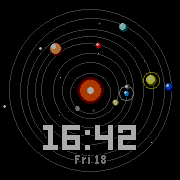
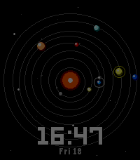
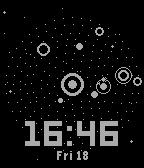

# orbital-face

A Pebble watchface showing a live orrery: the Sun and the eight planets at
their real heliocentric positions right now, on a starfield, with the time
below. Shake your wrist and the planets come loose — they fall under real
inverse-square gravity, swing round the Sun, and glide back to the truth.

<p align="center">
  
  
  
</p>

## What it does

- **The planets are really there.** Positions come from Schlyter's orbital
  elements, solved each minute from the watch's own clock. No network, no
  ephemeris tables. Earth sits where Earth is; Saturn sits where Saturn is.
- **The orbits are ellipses, not circles.** Each path is drawn as a circle
  pushed off-centre toward aphelion, which is a first-order ellipse — so
  Mercury and Mars visibly lean, and a planet at perihelion really is closer
  to the Sun than it was six months ago.
- **Shake to play.** A flick of the wrist knocks every planet off its mark.
  What happens next is Kepler's, not an animation curve: a gentle nudge gives
  you near-circular drift, a hard flick drops a perihelion inside the Sun and
  slingshots the planet out the far side. They glide home over a window you
  set, and the sky goes back to telling the truth.
- **The Moon rides with Earth** at its real phase and elongation, so the dot
  beside Earth is on the same side of it as the Moon is tonight.
- **Motion trails**, a corona that breathes, a starfield that twinkles, a Sun
  that flares on the minute, and planets that spiral out of the Sun on launch.
- **The Sun is tinted by the time of day** — indigo before dawn, orange at
  sunrise, yellow at midday, orange at dusk.
- **Roughly thirty settings**, on a Clay configuration page: clock format and
  position, date format, battery (percentage, edge ring, or only when low),
  Bluetooth and step display, five colours, starfield density, planet size,
  trails and trail length, which planets to show, and the physics itself —
  fling strength, gravity, and how long before everything settles.

It runs on every Pebble display, colour or black-and-white, round or
rectangular. All geometry derives from the real screen bounds, and the
monochrome build is its own design rather than a colour one squeezed down:
orbit paths become dotted rings, and planets get black halos so they stay
legible against them.

## Building & running

```sh
npm install                        # pulls the Clay config library
pebble build                       # builds for every targetPlatform
pebble install --emulator emery
pebble install --phone <ip>
```

Settings are reachable from the Pebble phone app, or in the emulator with
`pebble emu-app-config`.

## Releasing

`pebble build` writes `build/orbital-face.pbw`, which is the single file the
appstore wants — it carries the binaries for all seven platforms plus the JS.
Bump `version` in `package.json` before building; the appstore rejects a
re-upload of a version it already has.

> **Version 2.0.0 has not been uploaded to the appstore yet.** Everything
> published so far is 1.0.0, which is the build that showed a frozen, made-up
> sky (see the note on `astro.c` below). Uploading 2.0.0 is the outstanding
> job on this repo.

## Notes for anyone working on this

**The physics is fussier than it looks.** Three things in `src/c/physics.c`
are the way they are because the obvious version failed slowly and
confusingly, and all three are commented in place:

1. *Fixed point is Q16, not Q8.* At Q8 the gravity components round to zero
   near the axes on the outer rings. The orbit degenerates into a polygon,
   gains energy every lap and eventually leaves the screen.
2. *Separations are kept to sub-pixel precision.* Rounding the planet-to-Sun
   distance to whole pixels before computing gravity puts a hard floor of
   about 15% radius wobble on the innermost ring, however finely you substep.
3. *The recapture is a positional blend, not a spring.* Fading a spring in
   while gravity is still on bleeds orbital velocity, and the planet spirals
   into the Sun instead of gliding home. The simulation stays purely Keplerian
   — nothing ever removes energy from it — and the planet is drawn on a
   smoothstep between its free trajectory and its true position, so arrival is
   guaranteed by construction.

There is a host-side model of the same integer arithmetic under `tools/`,
which is a far faster way to check a change to the dynamics than watching the
emulator.

**The astronomy is integer-only on purpose.** Version 1 of this face used
single-precision libm, crashed at launch, and shipped a "diagnostic" build
that placed the planets at eight fixed, evenly-spaced angles — frozen forever,
while the README claimed real positions. `src/c/astro.c` replaces that with
the series expansion of the equation of centre in Pebble trig units: no
floating point, no `atan2`, no unbounded loop, nothing that can run the stack
out during `window_load`. It is accurate to better than 0.1° for every planet,
against a display where one pixel is about 2° of arc.

**Screenshots.** `pebble screenshot` stops responding once the host is under
memory pressure or a button has been pressed. `tools/shot.py <platform> <out>`
goes through QEMU's own monitor socket instead, which is a completely separate
path and keeps working.

**`ORBITAL_DEBUG=1 pebble build`** adds an on-screen counter readout (taps,
flings, whether a body is loose, recapture progress) and makes the face fling
itself on launch — the emulator's tap injection also goes through the wedgeable
path, so this is how you get at the physics from a plain screendump.

## Project layout

```
src/c/
  orbital.h     shared types, settings struct, module interfaces
  astro.c       heliocentric positions and moon phase, integer only
  scene.c       screen geometry, colour fading, integer square roots
  physics.c     the toy: gravity, flinging, recapture
  render.c      everything that touches a GContext
  settings.c    persistence and the AppMessage inbox
  main.c        app lifecycle; one window, one layer, one timer
src/pkjs/
  index.js      PebbleKit JS entry
  config.js     the Clay settings page
tools/
  shot.py       screenshot via the QEMU monitor
screenshots/    images used above
```

The frame timer only runs while something is actually moving. With the physics
idle the face redraws once a minute and costs nothing.

## Documentation

Full SDK docs, tutorials, and API reference: <https://developer.repebble.com>
