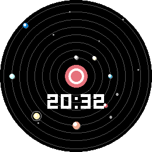

# orbital-face

A watchface showing a small orrery of the solar system — the Sun and the
eight planets at their real heliocentric positions today (Paul Schlyter's
low-precision method), tinted by time of day. Shake the watch to nudge the
planets with a damped spring physics response. Written in C using the
Pebble SDK.

<p align="center">
  
  
</p>

## Features

- Real planetary positions computed from orbital elements each minute — not
  a fixed decorative animation — using single-precision trig to stay light
  on Pebble's FPU-less core.
- The Sun's tint shifts through the day (indigo pre-dawn, orange sunrise,
  yellow midday, orange dusk, indigo night).
- **Shake-to-play**: tapping/shaking the watch knocks the planets off their
  orbital positions with a damped spring that settles back over ~30 seconds.
- Digital time displayed below the sun.
- Fully resolution-independent — the sun radius, orbit ring spacing, and
  starfield all derive from the real screen bounds at load time, so it
  looks right on round and rectangular displays alike.

## Building & running

```sh
pebble build                          # build for all targetPlatforms
pebble install --emulator emery       # install on the emery emulator
pebble install --phone <ip>
```

## Target platforms

All geometry is derived from the real screen bounds at load time, so this
runs on any display size/shape (`aplite`, `basalt`, `chalk`, `diorite`,
`emery`, `flint`, `gabbro` — see `targetPlatforms` in `package.json`).

## Project layout

```
src/c/           C source for the watchface
screenshots/     Emulator screenshots used in this README
package.json     Project metadata (UUID, platforms, resources, message keys)
wscript          Build rules — usually no need to edit
```

## Documentation

Full SDK docs, tutorials, and API reference: <https://developer.repebble.com>
