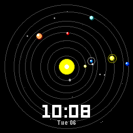
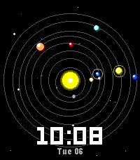
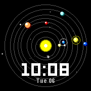
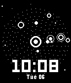
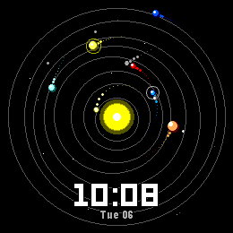
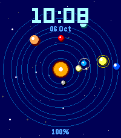
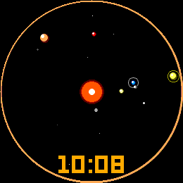

# Orbital

A Pebble watchface showing a live orrery: the Sun and the eight planets at
their real heliocentric positions right now, on a starfield, with the time
below. Shake your wrist and the planets come loose: they fall under real
inverse-square gravity, swing round the Sun, and glide back to the truth.

Runs on every Pebble: aplite, basalt, chalk, diorite, emery (Time 2), flint
and gabbro (Round 2).

On the Rebble appstore as
[Orbital](https://apps.repebble.com/orbital_ca95ffb257bb4ae484d2de7f) (v2.0.0).

 
 

<p>
  
  
  
</p>

## What it does

- **The planets are really there.** Positions come from Schlyter's orbital
  elements, solved each minute from the watch's own clock. No network, no
  ephemeris tables. Earth sits where Earth is; Saturn sits where Saturn is.
- **The orbits are ellipses, not circles.** Each path is drawn as a circle
  pushed off-centre toward aphelion, which is a first-order ellipse, so
  Mercury and Mars visibly lean, and a planet at perihelion really is closer
  to the Sun than it was six months ago.
- **Shake to play.** A flick of the wrist knocks every planet off its mark.
  What happens next is Kepler's, not an animation curve: a gentle nudge gives
  you near-circular drift, a hard flick drops a perihelion inside the Sun and
  slingshots the planet out the far side. They glide home over a window you
  set, and the sky goes back to telling the truth.
- **The Moon rides with Earth** at its real phase and elongation, so the dot
  beside Earth is on the same side of it as the Moon is tonight.
- **Motion trails**, a corona that breathes, a starfield that twinkles, a Sun
  that flares on the minute, and planets that spiral out of the Sun on launch.
- **The Sun is tinted by the time of day**: indigo before dawn, orange at
  sunrise, yellow at midday, orange at dusk.

The monochrome build is its own design rather than a colour one squeezed
down: orbit paths become dotted rings, and planets get black halos so they
stay legible against them. All geometry derives from the real screen bounds.

## Using it

- **Shake or flick your wrist** (the accelerometer's tap event) to fling the
  planets. Shaking again while they are loose kicks them again and restarts
  the settle timer.
- They glide back after **Settle back after** seconds (20 by default). They
  fly free for the first three quarters of that, then blend home.
- Opening the face plays the spiral-out intro, if it's on.

## Settings (Clay)

Reachable from the Pebble phone app, or `pebble emu-app-config` in the
emulator.

| Setting | Default | Notes |
|---|---|---|
| Clock | Match watch setting | 12 or 24 hour |
| Leading zero | On | |
| Clock position | Bottom | Bottom, centre (over the Sun) or top. The status line sits opposite |
| Date | `Mon 18` | Hidden, `Mon 18`, `18 Sep`, `18/09`, `Sep 18` |
| Battery | Only when low | Hidden, always a percentage, a ring round the edge, or only when low. The ring is a circle on round watches and follows the screen edge on rectangular ones |
| Low battery at | 20% | 5–50% |
| Bluetooth dot when disconnected | On | |
| Vibrate on disconnect | Off | |
| Show today's step count | Off | Platforms with health only |
| Background / Clock / Date & status / Orbit paths | `000000` / `FFFFFF` / `AAAAAA` / `555555` | Colour watches only |
| Sun follows the time of day | On | Off uses the Sun colour below |
| Sun (when not automatic) | `FFFF00` | |
| Draw orbit paths | On | |
| Include Uranus & Neptune | On | Off spreads the inner six across the screen |
| Planet size | Normal | Small, normal, large |
| Starfield | Normal | None, sparse, normal, dense |
| Ring around Earth | On | |
| Show the Moon at its real phase | On | |
| Shake to play | On | |
| Fling strength | 60 | 0–100 |
| Gravity | 50 | 0–100, scales GM between 30% and 200% |
| Settle back after | 20s | 3–60s |
| Motion trails | On | |
| Trail length | 12 | 0–24 |
| Nudge itself every minute | Off | A small automatic fling on each minute tick |
| Spiral in on launch | On | |
| Sun flares on the minute | On | |

Uses `@rebble/clay`, not `pebble-clay`, which refuses to build for flint and
gabbro.

## Battery

The frame timer only runs while something is actually moving. With the
physics idle the face redraws once a minute. The things that run it:

- a fling, for the settle time (20s by default)
- the launch intro, about 1.2s
- the minute flare, about 0.7s each minute (turn off **Sun flares on the
  minute** to skip it)
- **Nudge itself every minute**, which flings on every tick, so with the
  default settle time the face animates for a third of every minute. It is off
  by default for that reason.

Shake detection uses the accelerometer's built-in tap event, which costs
nothing between taps.

## How it works

**The physics is fussier than it looks.** Three things in `src/c/physics.c`
are the way they are because the obvious version failed slowly and
confusingly, and all three are commented in place:

1. *Fixed point is Q16, not Q8.* At Q8 the gravity components round to zero
   near the axes on the outer rings. The orbit degenerates into a polygon,
   gains energy every lap and eventually leaves the screen.
2. *Separations are kept to sub-pixel precision.* Rounding the planet-to-Sun
   distance to whole pixels before computing gravity puts a hard floor of
   about 15% radius wobble on the innermost ring, however finely you substep.
3. *The recapture is a positional blend, not a spring.* Fading a spring in
   while gravity is still on bleeds orbital velocity, and the planet spirals
   into the Sun instead of gliding home. The simulation stays purely Keplerian
   (nothing ever removes energy from it) and the planet is drawn on a
   smoothstep between its free trajectory and its true position, so arrival is
   guaranteed by construction.

The screen edge is an elastic wall. An absorbing one is an energy sink that
silently decays any orbit that reaches it.

**The astronomy is integer-only on purpose.** Version 1 of this face used
single-precision libm, crashed at launch, and shipped a "diagnostic" build
that placed the planets at eight fixed, evenly-spaced angles, frozen forever,
while the README claimed real positions. `src/c/astro.c` replaces that with
the series expansion of the equation of centre in Pebble trig units: no
floating point, no `atan2`, no unbounded loop, nothing that can run the stack
out during `window_load`. It is accurate to better than 0.1° for every planet,
against a display where one pixel is about 2° of arc.

## Build and test

```sh
npm install                        # pulls the Clay config library
pebble build                       # release bundle: build/orbital-face.pbw
pebble install --emulator emery
pebble install --phone <ip>
python3 tools/shot.py emery out.png          # screenshot via the QEMU monitor
python3 tools/record.py emery /tmp/rec 10    # timestamped frames
pebble emu-tap --emulator emery              # flick
python3 tools/orbit_sim.py                   # host-side model of the physics
```

`pebble screenshot` stops responding once the host is under memory pressure or
a button has been pressed. `tools/shot.py` and `tools/record.py` go through
QEMU's own monitor socket instead, which is a separate path and keeps working.
They also snap the dump's colours back to the watch's real levels: emulator
screendumps write each channel on a reduced per-platform scale under a `255`
header, so raw captures look dim. Append `@<sdk>` to the platform
(`gabbro@4.33.1`) to pick one SDK's emulator when two are running.

`tools/orbit_sim.py` models the same integer arithmetic as `physics.c`. It is
a far faster way to check a change to the dynamics than watching the emulator.

Verification-only build flags (never ship a bundle built with them):

- `ORBITAL_DEBUG=1 pebble build` adds an on-screen counter readout (taps,
  flings, whether a body is loose, recapture progress) and makes the face
  fling itself on launch.
- `ORBITAL_SHOW_TIME=1008` pins the clock and the Sun's tint to 10:08, and
  ignores saved settings so the emulator's flash can't leak into a shot.
- `ORBITAL_PRESET=1` (Nebula) or `2` (Ember), with `ORBITAL_SHOW_TIME`: the
  alternative looks used in the store screenshots. See `store_preset()` in
  `settings.c`.
- `ORBITAL_DEMO_FLING=<seconds>`, with `ORBITAL_SHOW_TIME`: flings once that
  long after launch, with the settle time cut to 9s.

## Store assets

`store/` holds the appstore set: five files for each of the seven platforms,
each at the platform's native size, plus the listing text.

| File | Shows |
|---|---|
| `<platform>_1_preview.gif` | The settled sky, a fling, and the glide home (settle time cut to 9s) |
| `<platform>_2_time.png` | 10:08, default settings |
| `<platform>_3_fling.png` | The planets loose, with trails |
| `<platform>_4_nebula.png` / `_4_top.png` (B&W) | Navy and ice, clock on top, large planets, battery percentage |
| `<platform>_5_ember.png` / `_5_minimal.png` (B&W) | No orbit paths, inner six planets, battery ring |
| `icon_80x80.png`, `icon_144x144.png` | `--icon-small` / `--icon-large` |
| `banner_720x320.png` | Store header (optional) |
| `listing.md` | Short and full descriptions, release notes |

Filenames start with the platform because `pebble publish` works out the
platform from the text before the first underscore.

The GIFs play at the watch's designed 30fps, not the emulator's speed. On a
memory-starved Mac the emulator runs the fling at about half speed, with
stalls, so `record.py` dumps every 20ms (faster than the 33ms frame timer),
`store_assets.py` keeps each distinct frame once, and each gets 33ms.

To regenerate (about 4 minutes per platform; this runs `pebble kill` between
platforms, so check no other session is using the emulators):

```sh
python3 tools/record_store.py /tmp/orbital_rec      # or name platforms to redo,
                                                    # and --only ember to redo one variant
python3 tools/store_assets.py /tmp/orbital_rec
pebble build                                        # back to a release build
```

`record_store.py` builds the three variants with the flags above, installs
each one, checks the Sun is in the middle of the screen (the emulator
sometimes keeps the previous face through an install), and records it.

## Releasing

Version 2.0.0 has been live on the store since 2026-10-06. It replaced 1.0.0,
the build that showed a frozen, made-up sky (see the astronomy note above).

Orbital already exists on the store, so `pebble publish` adds a release to the
existing app (matched by UUID) rather than creating one. Read
`pebble_tool/commands/publish.py` before trusting the flags:

- **The release goes live immediately.** The existing-app path sends
  `isPublished: true` whatever you pass.
- **Screenshots are added, not replaced** (`replaceScreenshots: false`), so
  remove the previous release's shots on the developer dashboard afterwards.
- `--description`, `--icon-*`, `--name` and `--category` only apply when
  creating a new app. Update the description and icons on the dashboard, from
  `store/listing.md` and `store/icon_*.png`.
- If the server rejects the screenshots it silently retries without them.

Bump `version` in `package.json` first if the store already holds it.
`pebble publish` runs its own `pebble build`, so make sure no `ORBITAL_*`
variables are set in the shell. Then, after `pebble login`:

```sh
pebble publish --non-interactive \
  --release-notes "$(sed -n '/^## Release notes/,$p' store/listing.md | tail -n +3)" \
  --screenshots store/*_[1-5]_*.{gif,png}
```

## Project layout

```
src/c/
  orbital.h     shared types, settings struct, module interfaces
  astro.c       heliocentric positions and moon phase, integer only
  scene.c       screen geometry, colour fading, integer square roots
  physics.c     the toy: gravity, flinging, recapture
  render.c      everything that touches a GContext
  settings.c    persistence, the AppMessage inbox, store presets
  main.c        app lifecycle; one window, one layer, one timer
src/pkjs/
  index.js      PebbleKit JS entry
  config.js     the Clay settings page
tools/
  shot.py           screenshot via the QEMU monitor
  record.py         timestamped frames via the QEMU monitor
  record_store.py   records every store variant on every platform
  store_assets.py   builds store/ from those recordings
  orbit_sim.py      host-side model of the physics
store/          appstore screenshots, GIFs, icons, banner, listing text
```

## Documentation

Full SDK docs, tutorials, and API reference: <https://developer.repebble.com>
